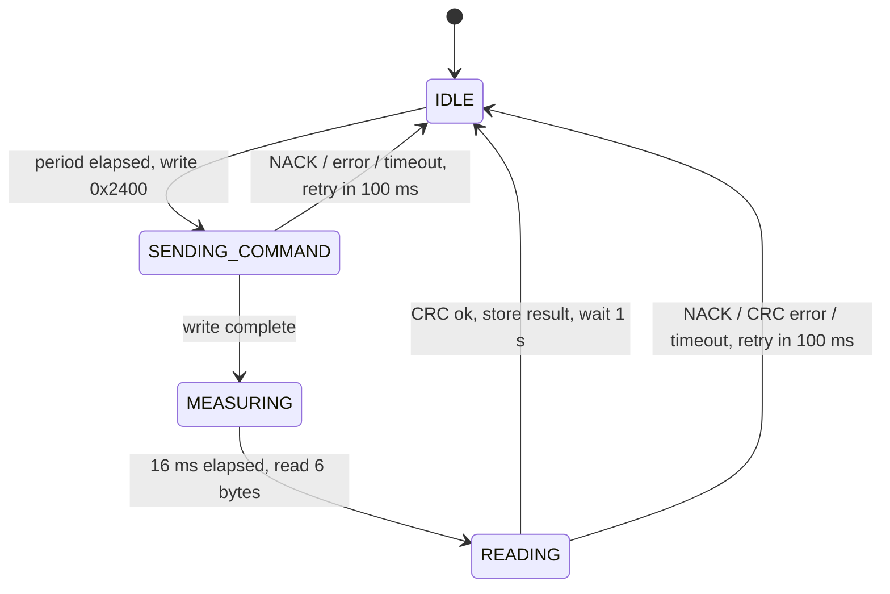

# SHT3x Driver for STM32F0 (register-level I2C, non-blocking)

[](https://github.com/emirkls44/STM32_I2C_TEMP_SHT3X_Modular/actions/workflows/ci.yml)

Temperature and humidity measurement with a Sensirion SHT3x (SHT30/31/35) on an STM32F0DISCOVERY
board. The I2C master driver is written directly against the I2C1 registers and is interrupt
driven; the sensor driver is a non-blocking state machine, so the main loop never waits on the bus.

## Features

- Interrupt-driven I2C1 master (no HAL I2C), 100 kHz
- Non-blocking measurement cycle: command → 16 ms conversion → 6-byte read
- CRC-8 check of both data words (polynomial 0x31, init 0xFF); corrupted readings are discarded
- Recovers from a missing sensor (NACK), bus/arbitration errors and stuck transfers (peripheral reset)
- One measurement per second to keep the sensor's self-heating negligible
- Error counters (`i2c_errors`, `crc_errors`, `timeouts`) for diagnostics
- Host unit tests for the state machine, CRC and conversion; CI builds the firmware

## Wiring

| SHT3x | STM32F0DISCOVERY |
|-------|------------------|
| VDD   | 3V               |
| GND   | GND              |
| SCL   | PB6              |
| SDA   | PB7              |
| ADDR  | GND (address 0x44) |

SCL and SDA need pull-up resistors to 3.3 V (4.7 kΩ is typical; many breakout boards already
have them).

## How it works



**Design notes**

- Command `0x2400` is a single-shot, high-repeatability measurement *without* clock stretching.
  The driver waits the datasheet's maximum conversion time (15.5 ms) instead of letting the sensor
  hold SCL low, so a slow or faulty sensor can never block the bus.
- `I2C1_WriteAsync()` copies the data into the driver. An earlier version kept a pointer to a
  local array in `SHT3x_Update()`; the interrupt then read it after the function had returned.
- Variables shared with the I2C interrupt are `volatile`.
- The I2C timing value `0x10420F13` is the RM0091 setting for 100 kHz with an 8 MHz I2C clock. I2C1
  runs from the HSI by default, so it does not change if the system clock is raised.
- Conversion formulas (datasheet section 4.13): T = −45 + 175 · raw / 65535 °C,
  RH = 100 · raw / 65535 %.

## Reading the values

The STM32F0DISCOVERY's ST-LINK has no virtual COM port, so the results are kept in global
variables. In STM32CubeIDE add `g_temperature_c`, `g_humidity_rh` and `g_sht3x_stats` to
*Live Expressions* while debugging. The green LED (PC9) toggles on every valid measurement.

## Building

**STM32CubeIDE:** import the folder as an existing project and build. `main.c` is hand-written (the
I2C peripheral is not configured in the `.ioc`), so do not regenerate code from CubeMX.

**Command line:**

```sh
cmake -S . -B build -DCMAKE_TOOLCHAIN_FILE=cmake/arm-none-eabi.cmake -DCMAKE_BUILD_TYPE=Release
cmake --build build
```

**Unit tests:**

```sh
make -C tests
```

## Files

```
Core/Src/i2c.c     register-level I2C1 master (interrupt driven)
Core/Src/sht3x.c   sensor state machine, CRC, conversion
Core/Src/main.c    demo: reads the sensor, updates the g_* variables
tests/             host unit tests with a fake I2C driver
```
